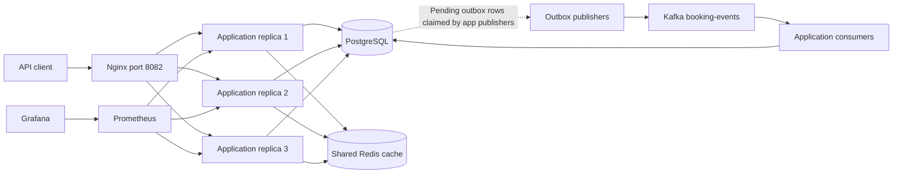
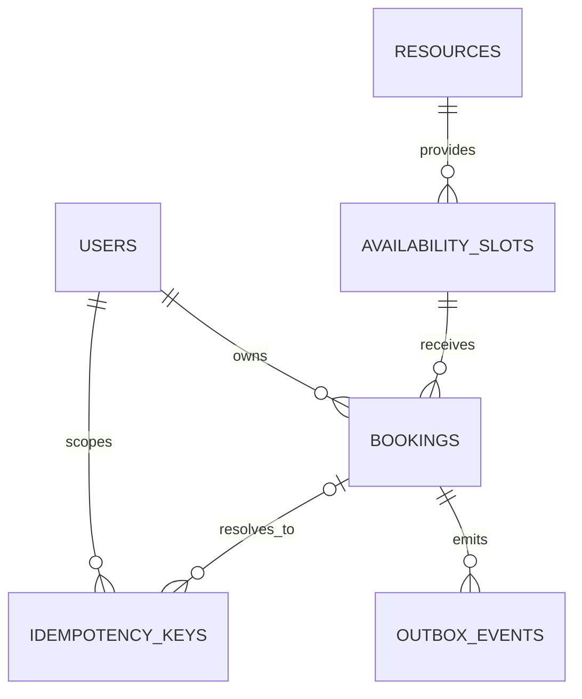
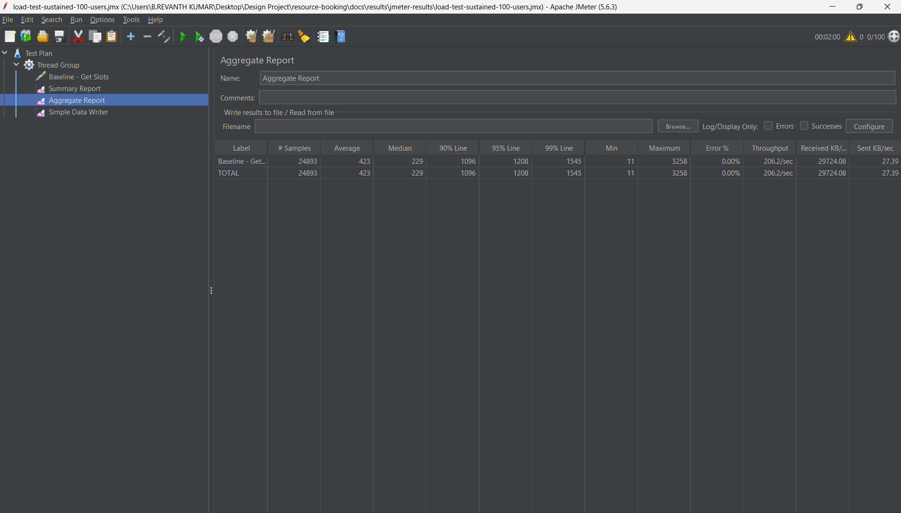
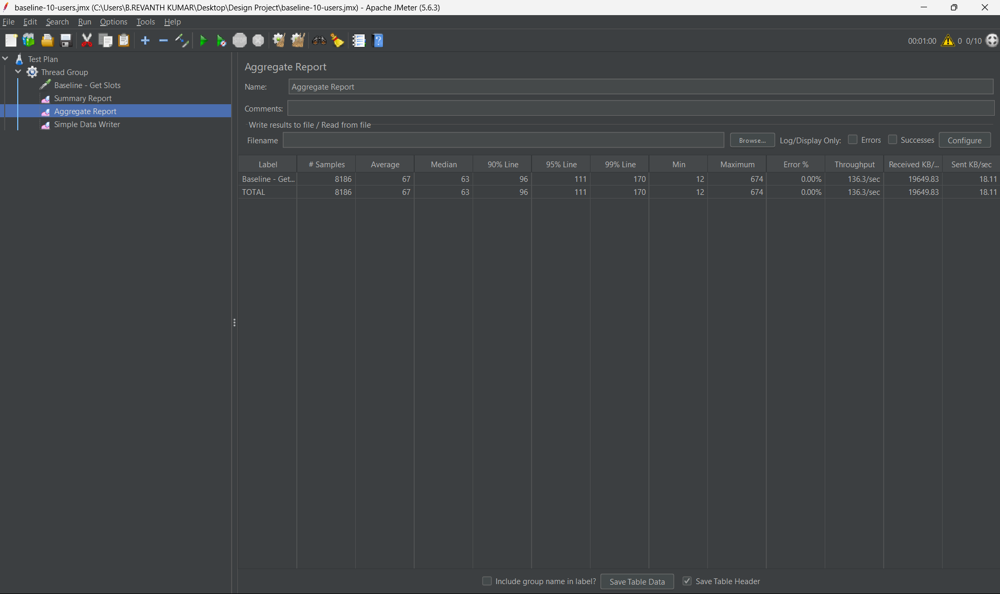
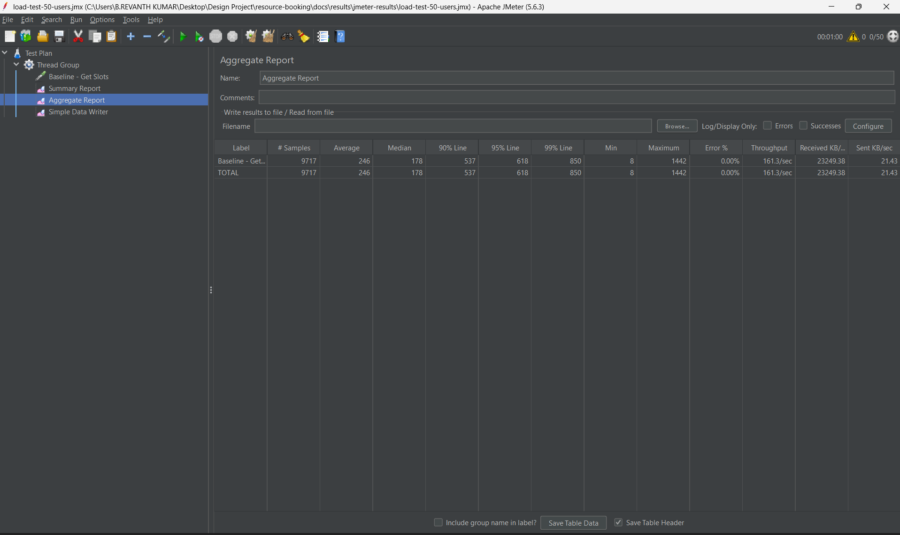
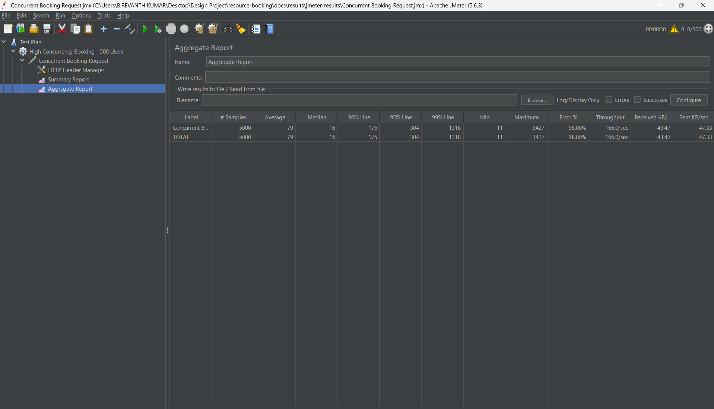
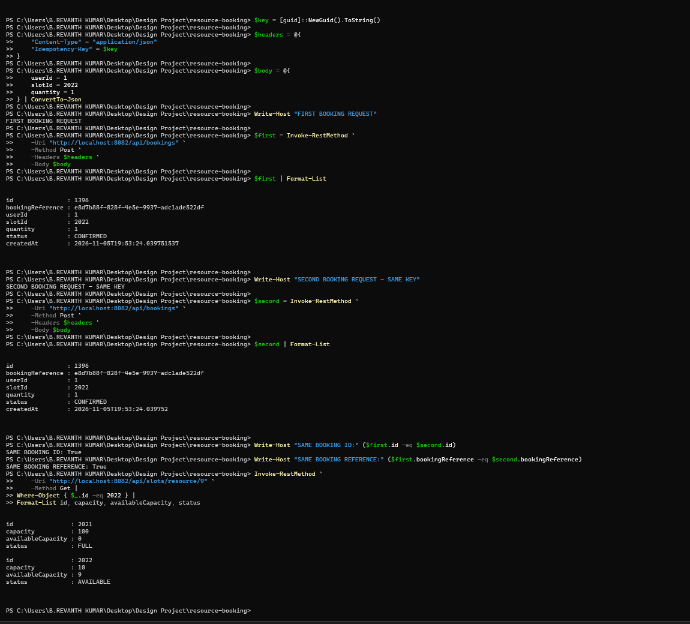
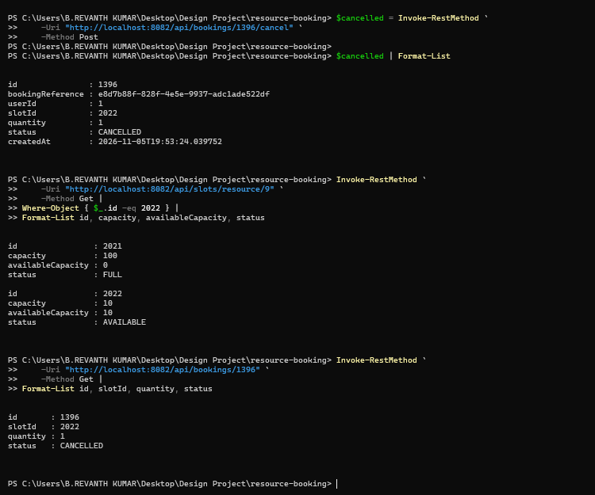
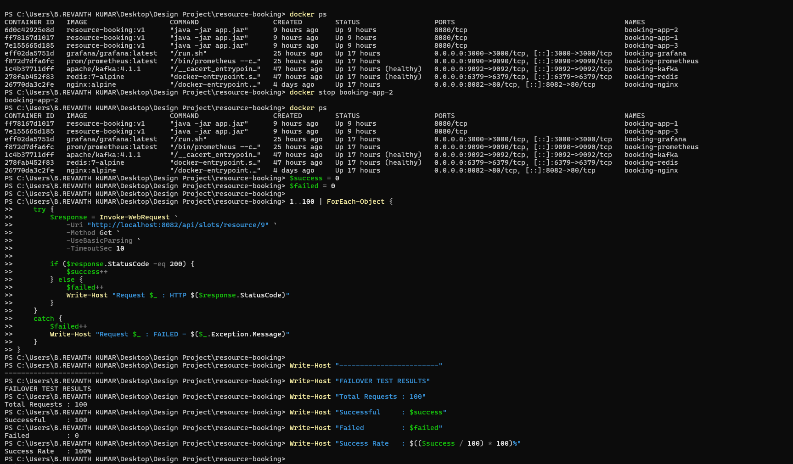
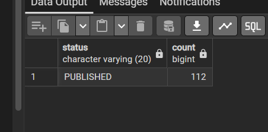

# Distributed Resource Booking System

### Reserve limited inventory safely across multiple backend replicas.

**Java 21 · Spring Boot 4.1.1 · PostgreSQL · Redis · Kafka · Docker · Nginx**

A backend engineering project addressing three practical booking problems: competing requests for the last available unit, duplicate requests after a retry, and event publication after a booking commits.

The system combines **atomic database reservation**, **transactional idempotency**, and a **transactional outbox**, with three application replicas behind Nginx. REST APIs support users, resources, availability slots, quantity-based bookings, history, and cancellation.

**[Explore the architecture](#architecture) · [See the results](#testing-and-results) · [Run locally](#build-and-run-with-docker-compose) · [Browse the API](#rest-api)**

> **Recorded highlights:** 24,893 read requests at 206.2 requests/sec in the documented 100-user run, with 0% recorded errors; matching-key retries returned the same booking; cancellation restored inventory; 100 sequential reads succeeded after one application replica was stopped. These observations apply to the documented workloads and local environment.

## Why this project?

A booking is more than a database insert. Separate availability reads and updates can oversell inventory. A client retry after a lost response can create another booking. A crash between booking commit and event publication can leave downstream systems uninformed.

| Challenge | Implemented approach |
| --- | --- |
| Competing reservations | Conditional capacity update inside a database transaction |
| Repeated creation requests | User-scoped idempotency key, request hash, and row lock |
| Competing cancellation attempts | Booking lock and status check |
| Booking/event consistency | Booking and outbox event saved in the same transaction |
| Multiple application instances | Shared PostgreSQL authority and Nginx request distribution |
| Repeated event delivery | Consumer-side event-ID deduplication table |

**Scope:** backend APIs and distributed coordination for capacity-based slots. Frontend, payments, assigned seats, and route-segment allocation are outside the current implementation.

## Contents

- [Technology stack](#technology-stack)
- [Architecture](#architecture)
- [Design and correctness](#design-and-correctness)
- [Data model](#data-model)
- [Testing and results](#testing-and-results)
- [Requirements](#requirements)
- [Build and run](#build-and-run-with-docker-compose)
- [REST API](#rest-api)
- [Automated tests](#automated-tests)
- [Observability](#observability)
- [Limitations and future work](#limitations-and-future-work)
- [Repository guide](#repository-guide)
- [Team](#team)
- [References](#references)
- [License](#license)


## Technology stack

| Component | Technology | Role |
| --- | --- | --- |
| Language | Java 21 | Backend implementation |
| Framework | Spring Boot 4.1.1 / Spring MVC | Application and REST endpoints |
| Persistence | Spring Data JPA / PostgreSQL | Transactional source of truth |
| Validation | Jakarta Bean Validation | HTTP request validation |
| Password storage | Spring Security Crypto / BCrypt | Password hashing |
| Cache | Redis / Spring Cache | Resource-list caching |
| Messaging | Apache Kafka / Spring Kafka | Asynchronous booking events |
| Deployment | Docker Compose / Nginx | Containers and request distribution |
| Monitoring | Actuator / Micrometer / Prometheus / Grafana | Health and metrics |
| Tests / build | JUnit / Mockito / Maven Wrapper | Verification and packaging |

Password hashing does not provide authentication or endpoint authorization; these are future work.

## Architecture



Compose configures one Spring Boot application as three replicas. Submitted Nginx logs show traffic reaching all three replicas. PostgreSQL is the authority for booking capacity; Redis and Kafka do not decide whether a booking succeeds. Publisher and consumer boxes are components inside the application replicas, not additional standalone services.

### Booking lifecycle

1. Validate the HTTP request and require an `Idempotency-Key` header of 1–200 characters.
2. Insert or lock the key scoped to the supplied user ID, and compare a SHA-256 hash of user, slot, and quantity.
3. Atomically decrement capacity only when the slot is `AVAILABLE` and enough units remain.
4. Save a `CONFIRMED` booking, complete the idempotency record, and insert `BOOKING_CREATED` into the outbox in the same database transaction.
5. A publisher runs with a five-second delay after the previous invocation completes. It claims up to 100 pending events using `FOR UPDATE SKIP LOCKED`, sends them to Kafka, and marks them published.
6. The consumer inserts the event ID using `ON CONFLICT DO NOTHING`; its current business action is logging.

Cancellation locks the booking, restores capacity with an upper-bound check, marks it `CANCELLED`, and writes a `BOOKING_CANCELLED` outbox event in one transaction. Repeated cancellation currently returns a conflict.

Publication can repeat after failures. Delivery is not exactly-once and per-booking event ordering is not guaranteed. Idempotency expiry timestamps are stored, but expiry and cleanup are not implemented.

## Design and correctness

### Atomic capacity reservation

The reservation query updates a slot only when its status is `AVAILABLE` and its available capacity is at least the requested quantity. Capacity deduction and the decision to mark the slot `FULL` happen in one database statement. This avoids an application-level read-check-write race.

The service checks the affected-row count: zero rows means the reservation did not succeed. Booking creation, idempotency completion, and outbox insertion share one transaction; runtime exceptions in this path trigger rollback of their database changes. This does not make external actions or failures after commit reversible.

Implementation: [BookingService](src/main/java/com/resourcebooking/booking/service/BookingService.java) and [AvailabilitySlotRepository](src/main/java/com/resourcebooking/booking/repository/AvailabilitySlotRepository.java).

```mermaid
sequenceDiagram
    participant C as API client
    participant A as Booking service
    participant D as PostgreSQL
    participant P as Outbox publisher
    participant K as Kafka
    C->>A: Booking request + Idempotency-Key
    A->>D: Begin transaction; insert or lock user/key
    alt Completed key with matching request hash
        D-->>A: Associated booking
        A->>D: Commit
        A-->>C: Existing booking current state
    else New request
        A->>D: Conditional capacity update
        alt No capacity reserved
            A->>D: Roll back
            A-->>C: HTTP 409
        else Reservation succeeds
            A->>D: Save booking, complete key, insert outbox event
            A->>D: Commit
            A-->>C: HTTP 201 with booking
        end
    end
    P->>D: Claim pending outbox rows in separate transaction
    P->>K: Publish event and await acknowledgement
    P->>D: Mark published and commit
```

### Idempotent creation

Keys are scoped by `(user_id, key)`. The service hashes user ID, slot ID, and quantity, then locks the idempotency row. A completed matching request returns the associated booking; a changed request using the same key is rejected. The design relies on the database's unique constraint and transactional locking.

### Safe cancellation

```mermaid
sequenceDiagram
    participant C as API client
    participant A as Booking service
    participant D as PostgreSQL
    C->>A: Cancel booking
    A->>D: Begin transaction; lock booking FOR UPDATE
    alt Booking is not CONFIRMED
        A->>D: Roll back
        A-->>C: HTTP 409
    else Booking is CONFIRMED
        A->>D: Restore capacity with upper-bound and status checks
        alt Capacity cannot be restored
            A->>D: Roll back
            A-->>C: HTTP 409
        else Restoration succeeds
            A->>D: Set CANCELLED; insert cancellation outbox event
            A->>D: Commit
            A-->>C: Cancelled booking
        end
    end
```

Locking the booking serializes competing cancellations. The capacity update also prevents restoration above slot capacity. The current implementation rejects cancellation when the slot is `BLOCKED` or `CLOSED`; this policy needs refinement.

### Event delivery and tradeoffs

The outbox avoids requiring a synchronous Kafka send during booking creation. A successful booking leaves a committed event for later publication. Publishers use `SKIP LOCKED` to claim different pending rows across replicas. The consumer inserts processed event IDs within a database transaction and currently logs the payload. Console logging is an external side effect and is not rolled back with that transaction; the implementation does not demonstrate exactly-once business side effects.

Important boundaries:

- A crash after Kafka accepts a message but before publication status commits can cause redelivery.
- Event IDs support deduplication; they do not establish per-booking ordering.
- A batch publication failure can cause earlier messages in that batch to be sent again.
- Three application replicas improve application-layer redundancy; shared infrastructure availability needs separate design.

### Why these components?

The implementation offers the following benefits and tradeoffs:

| Decision | Reason | Tradeoff |
| --- | --- | --- |
| PostgreSQL conditional updates | Coordinate inventory across application replicas | Hot slots can create database contention |
| Transactional idempotency records | Resolve client retries without a second reservation | Requires retention and expiry policy |
| Transactional outbox | Persist booking and event intent atomically | Adds polling, lag, and duplicate-delivery handling |
| Redis resource cache | Reduce repeated resource-list reads | Adds cache availability and invalidation concerns |
| Kafka events | Decouple asynchronous processing from booking requests | Adds broker operation and recovery complexity |
| Replicated application behind Nginx | Distribute requests across instances | Database and broker remain shared dependencies |

## Data model



| Table | Responsibility |
| --- | --- |
| `users` | User details, BCrypt password hashes, and status |
| `resources` | Resource metadata, capacity, and type ID |
| `availability_slots` | Resource time window, capacity, available capacity, and status |
| `bookings` | Reference, user, slot, quantity, and booking status |
| `idempotency_keys` | User/key uniqueness, request hash, associated booking, and expiry timestamp |
| `outbox_events` | Event ID, aggregate reference, JSON payload, and publication status |
| `processed_events` | Event-ID deduplication records |

The diagram represents logical references, not verified foreign keys in the external database. Resource type IDs are stored, but no resource-type catalog/API is supplied. The implemented booking path uses `CONFIRMED` and `CANCELLED`; extra enum values do not imply implemented holds or expiry processing.


## Testing and results

This section summarizes the artifacts at revision **`7829632`**. Screenshots record observed executions; they do not establish a maximum system capacity or independently reproduce a run.

**[Detailed test notes](docs/results/test-notes.md) · [JMeter plans and raw files](docs/results/jmeter-results/) · [All screenshots](docs/results/screenshots/)**

### Read performance

Endpoint: `GET /api/slots/resource/1`, through Nginx on port `8082`.

| Workload | Requests | Mean | p95 | p99 | Throughput | Recorded errors |
| --- | ---: | ---: | ---: | ---: | ---: | ---: |
| 10 users; 60 s; 10 s ramp-up | 8,186 | 67 ms | 111 ms | 170 ms | 136.3 req/s | 0% |
| 50 users; 60 s; 25 s ramp-up | 9,717 | 246 ms | 618 ms | 850 ms | 161.3 req/s | 0% |
| 100 users; 120 s; 30 s ramp-up | 24,893 | 423 ms | 1,208 ms | 1,545 ms | 206.2 req/s | 0% |
| 500 users; one request each; 60 s ramp-up | 500 | 93 ms | 343 ms | 704 ms | 8.3 req/s | 0% |

Values follow the submitted JMeter reports. Raw `.jtl` files for the first two runs contain 8,186 and 9,717 HTTP 200 samples respectively. The 100-user and 500-user runs have screenshots and plans, but their raw results are not committed. Small percentile differences can arise from calculation methods.

**Interpretation:** sustained throughput increased alongside latency. The 500-user single-iteration run is a ramped arrival test, not evidence of 500 simultaneously active requests. Virtual users and concurrent in-flight requests are different measures.



<details>
<summary>View baseline, 50-user, and 500-user reports</summary>






</details>

### Booking contention

The submitted plan configures **500 threads**, a **30-second ramp-up**, and **10 iterations**: 5,000 unit-booking requests against slot `2021`, with a documented initial capacity of 100. Each request generates a new idempotency key.

| Recorded measurement | Result |
| --- | ---: |
| HTTP samples | 5,000 |
| Successful HTTP samples | 100 |
| Failed HTTP samples | 4,900 |
| Aggregate throughput, including rejections | 166.0 req/s |
| Aggregate p95 / p99 latency | 304 / 1,318 ms |

The notes report 100 confirmed bookings, 100 booked units, and zero remaining capacity. Functional screenshots also show slot `2021` as `FULL` with zero availability. The dedicated booking-count/quantity verification artifact is not included.

**Interpreting the 98% JMeter error rate:** demand exceeded inventory, so most requests could not be fulfilled. Individual failed responses were not retained, however, so the artifacts cannot establish that all 4,900 failures were expected capacity conflicts. Throughput includes rejected requests; it is not successful bookings per second. The ramped plan does not establish 500 continuously active requests.



Use [Concurrent Booking Request.jmx](docs/results/jmeter-results/Concurrent%20Booking%20Request.jmx) as the booking plan. The separately named `booking-concurrency-500-users.jmx` contains exported HTTP headers, not a complete runnable JMeter plan.

### Functional and distributed behavior

| Scenario | Recorded observation | Evidence |
| --- | --- | --- |
| Sequential same-key retry | Both responses returned booking `1396`; remaining capacity was 9 of 10 | [Retry check](docs/results/screenshots/idempotency-test-complete.png.png) |
| Cancellation | Booking became `CANCELLED`; availability changed from 9 to 10 | [Cancellation check](docs/results/screenshots/cancellation-capacity-restoration.png.png) |
| Nginx distribution | Logs show all three backend IPs, matched to application containers | [Logs](docs/results/screenshots/nginx-load-balancing-verification.png.png), [IP mapping](docs/results/screenshots/nginx-replica-ip-mapping.png.png) |
| One replica stopped | 100 sequential GETs succeeded after stopping `booking-app-2` | [Replica-stop check](docs/results/screenshots/failover-100-requests.png.png) |
| Kafka publication | Console consumer retrieved 119 messages | [Kafka console](docs/results/screenshots/kafka-event-delivery.png.png) |
| Outbox status | Snapshot shows 112 `PUBLISHED` rows; notes report zero pending | [Database snapshot](docs/results/screenshots/kafka-outbox-published.png.png) |

The Kafka message count and outbox row count are separate observations, not proof of one-to-one delivery. Application-consumer processing and recovery under failure need further evidence. The replica-stop result demonstrates reads after stopping a replica, not uninterrupted in-flight bookings during a crash.

<details>
<summary>View retry and cancellation screenshots</summary>





</details>

<details>
<summary>View replica-stop and outbox screenshots</summary>





</details>

**Environment and evidence boundaries:** the notes identify three app replicas, Nginx, JMeter 5.6.3, and Windows PowerShell. Hardware, database/pool tuning, and load-generator isolation are not documented. The uploaded material does not substantiate a 10,000-concurrent-user result. No JUnit execution report accompanies this results set.


## Requirements

> **Database setup prerequisite:** the repository has no migrations or schema SQL and uses `ddl-auto=validate`. Install the matching schema first; an empty database is insufficient. Commands below are conditional on that prerequisite.

- JDK 21 and network access for Maven Wrapper downloads.
- Docker Engine/Desktop with Docker Compose for the supplied deployment.
- PostgreSQL reachable from containers at `host.docker.internal:5432`, database `resource_booking`, and a compatible preinstalled schema. PostgreSQL is not included in Compose.
- A database account matching the configuration (currently `postgres`). Use a dedicated least-privilege account for a hardened deployment.

The entities map `users`, `resources`, `availability_slots`, `bookings`, `idempotency_keys`, `outbox_events`, and `processed_events`. Native inserts omit `idempotency_keys.created_at` and `processed_events.processed_at`; the database must populate those required timestamps, for example through defaults or triggers. Idempotency requires a unique constraint on `(user_id, key)`; event deduplication requires a unique event ID. Recommended migrations should also define referential integrity, capacity/time checks, and appropriate indexes. The resource type catalog referenced by `resourceTypeId` is not implemented in this repository.

## Build and run with Docker Compose

Clone and enter the repository first:

```sh
git clone https://github.com/Revanth9783/distributed-resource-booking-system.git
cd distributed-resource-booking-system
```

After installing the matching PostgreSQL schema, set `DB_PASSWORD` in your shell or in an uncommitted `.env` file:

```dotenv
DB_PASSWORD=replace-with-your-local-database-password
```

Build the application JAR before building the image. The Dockerfile copies a prebuilt JAR and does not run Maven.

```sh
./mvnw clean package -DskipTests
docker compose up --build -d
docker compose logs -f app1
```

On Windows, use `./mvnw.cmd` instead of `./mvnw`. Skipping tests here only builds the deployment artifact; it does not establish correctness.

On Linux Docker Engine, `host.docker.internal` may require an explicit host-gateway mapping for each app service. Configure PostgreSQL to accept connections from the Docker network.

| Service | Local address |
| --- | --- |
| REST API through Nginx | http://localhost:8082 |
| Prometheus | http://localhost:9090 |
| Grafana | http://localhost:3000 |
| Redis | localhost:6379 |
| Kafka published port | localhost:9092 |

Kafka advertises `kafka:9092`, intended for containers on the Compose network. Host applications need a separate externally reachable advertised listener; changing the bootstrap address alone does not fix this.

Configure Grafana's Prometheus data source as `http://prometheus:9090`. No dashboards or data-source provisioning files are included.

```sh
docker compose down
```

Named volumes remain after this command. These instructions describe the supplied files; a fresh installation has not been independently verified.

## REST API

| Method | Path | Purpose |
| --- | --- | --- |
| POST | `/api/users` | Register user; password is BCrypt-hashed |
| POST | `/api/resources` | Create resource |
| GET | `/api/resources` | List resources; Redis cache TTL 60 seconds |
| POST | `/api/slots` | Create availability slot |
| GET | `/api/slots/resource/{resourceId}` | List slots directly from the database |
| POST | `/api/bookings` | Create booking; requires `Idempotency-Key` |
| GET | `/api/bookings/{bookingId}` | Read booking |
| GET | `/api/bookings/user/{userId}` | Read user booking history |
| POST | `/api/bookings/{bookingId}/cancel` | Cancel confirmed booking |
| GET | `/api/health` | Static application response; does not verify dependencies |
| GET | `/actuator/health` | Actuator health |
| GET | `/actuator/prometheus` | Prometheus metrics |

### Example workflow

Use returned IDs rather than assuming IDs start at 1. The resource type ID must match any requirements in your external schema.

```sh
curl -X POST http://localhost:8082/api/users -H 'Content-Type: application/json' -d '{"name":"Demo User","email":"demo@example.com","password":"DemoPassword123!"}'
curl -X POST http://localhost:8082/api/resources -H 'Content-Type: application/json' -d '{"resourceTypeId":1,"name":"Meeting Room A","description":"Demo room","capacity":4,"location":"Floor 1"}'
```

Choose future local date-times for both slot timestamps. The API currently uses `LocalDateTime` without an explicit timezone.

```json
{
  "resourceId": 1,
  "startTime": "2030-01-15T10:00:00",
  "endTime": "2030-01-15T11:00:00",
  "capacity": 4,
  "availableCapacity": 4
}
```

Submit that body to `POST /api/slots`, then use its returned ID (the curl examples use POSIX shell quoting; use `curl.exe` in PowerShell):

```sh
curl -X POST http://localhost:8082/api/bookings -H 'Content-Type: application/json' -H 'Idempotency-Key: demo-booking-001' -d '{"userId":1,"slotId":1,"quantity":1}'
curl http://localhost:8082/api/bookings/1
curl -X POST http://localhost:8082/api/bookings/1/cancel
```

Retrying the same key and request returns the associated booking's current state. Reusing the key with different booking details returns HTTP 409. Sold-out slots return HTTP 409. Validation errors return HTTP 400; missing bookings return HTTP 404.

Successful creation returns HTTP 201, including successful booking replays. Reads and successful cancellation return HTTP 200. A booking response includes `id`, `bookingReference`, `userId`, `slotId`, `quantity`, `status`, and `createdAt`. API endpoints currently have no authentication or ownership enforcement.


## Automated tests

```sh
./mvnw -Dtest=UserServiceTest test
./mvnw test
```

The unit tests check password hashing and duplicate-email rejection. The full suite includes an application-context test and a two-thread last-unit booking test. Integration tests currently use the normal application configuration and require external infrastructure and the existing schema. The concurrency test assumes users 1 and 2 exist and assigns resource type ID 1; whether a corresponding resource-type row is required depends on the external schema. Run against a disposable test database, never a production database. The concurrency test does not establish multi-instance or failure-recovery correctness.

Four test methods are present in source. This inventory is separate from a recorded passing execution. The concurrency test catches any exception as a failed booking attempt; precise rejection assertions remain an improvement. JMeter plans require matching fixtures, reset inventory, and updated machine-specific output paths before reproduction.


## Observability

Micrometer records booking requests, successes, failures, idempotent retries, and processing time. Prometheus scrapes each replica. Nginx access logs include upstream addresses for traffic-distribution checks.

The current success counter includes successful replays and increments before the surrounding transaction finishes committing. Treat it as an application-method metric, not a verified count of newly committed bookings.

## Limitations and future work

| Current boundary | Next improvement |
| --- | --- |
| No authentication, booking ownership, or admin roles | Identity-based access and service-layer permissions |
| External schema; no committed migrations | Versioned migrations and a reproducible development database |
| Missing resource-level overlap/capacity policy and booking eligibility checks | Enforce inventory rules, active status, and booking cutoffs |
| Cancellation rejects blocked/closed slots | Separate inventory restoration from administrative bookability |
| Idempotency expiry is stored but not enforced | Expiry, retention, and cleanup policies |
| Event publication can repeat and lacks per-booking ordering | Sequencing, retry isolation, replay, and backlog alerts |
| Sequential retry/cancellation evidence | Concurrent same-key, double-cancellation, and rollback tests |
| Limited failure evidence | Broker/database outage and in-flight crash-recovery tests |
| Quantity-based slots | Exclusive reservations, assigned seats, route segments, and payments |
| No committed CI or OpenAPI specification | Automated checks and a documented API contract |

Slot cache invalidation exists, but slot reads are not currently cached. Infrastructure ports and actuator endpoints need access restrictions before use beyond a trusted development environment. Shared PostgreSQL and a single Kafka broker have availability limits independent of application replication.

## Repository guide

```text
src/main/java/com/resourcebooking/booking/
  config/       Cache, Kafka, password, and JSON setup
  controller/   REST endpoints
  dto/          Request validation and response models
  entity/       Persistence models and status enums
  event/        Kafka consumer and cache invalidation
  exception/    Exceptions and HTTP error mapping
  repository/   Queries, conditional updates, and locks
  service/      Booking orchestration and outbox publisher
src/main/resources/application.properties
src/test/java/com/resourcebooking/booking/
docs/results/
  jmeter-results/   Plans and available raw results
  screenshots/     Recorded execution evidence
  test-notes.md    Detailed testing narrative
monitoring/prometheus.yml
nginx/nginx.conf
compose.yaml
Dockerfile
pom.xml
```

## Team

**B Revanth Kumar · J Shashivardhan · K Yuvaraju**

**Mentor:** Dr. Bhupendra Kumar

## References

- [Spring transactions](https://docs.spring.io/spring-framework/reference/data-access/transaction.html)
- [PostgreSQL transaction isolation](https://www.postgresql.org/docs/current/transaction-iso.html)
- [Spring for Apache Kafka](https://docs.spring.io/spring-kafka/reference/)
- [Transactional outbox pattern](https://microservices.io/patterns/data/transactional-outbox.html)
- [Apache JMeter](https://jmeter.apache.org/usermanual/index.html)

## License

No project license is included in the documented revision. Contact the maintainers regarding reuse terms.
